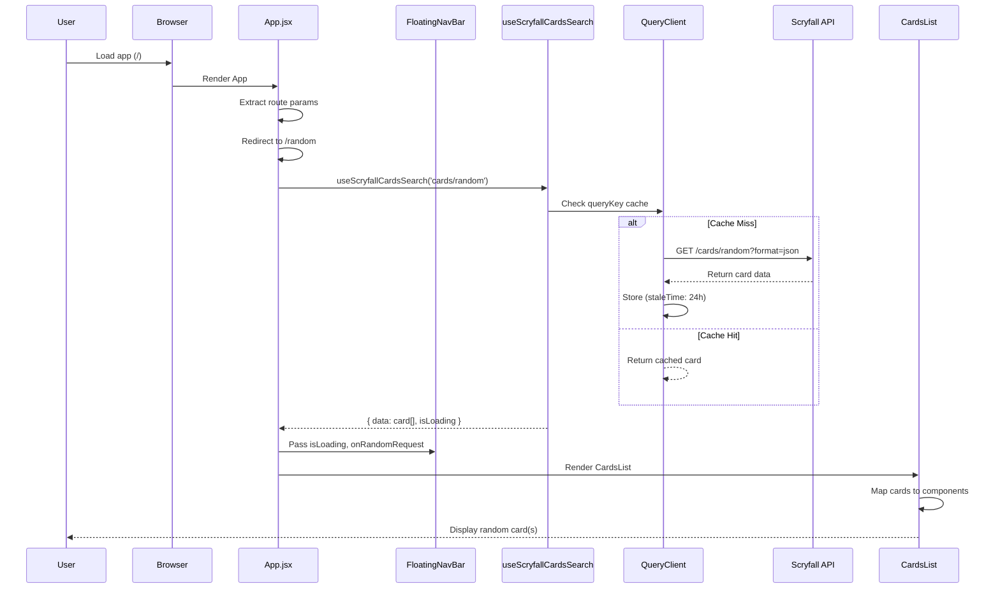
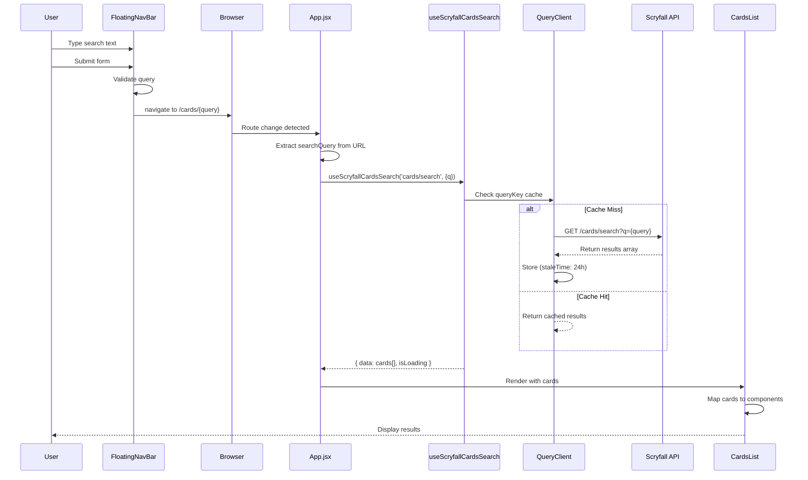
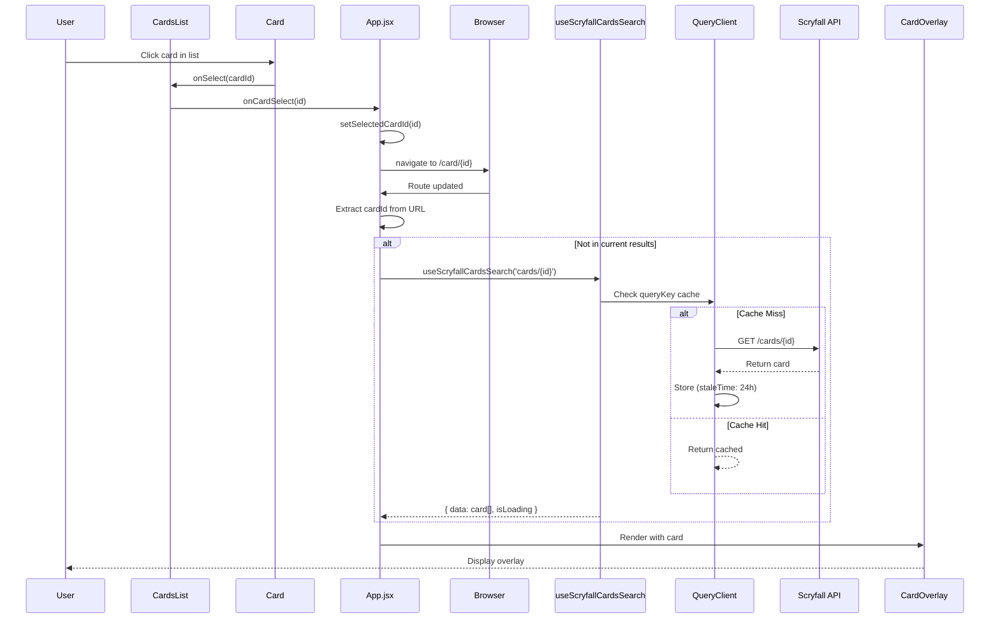
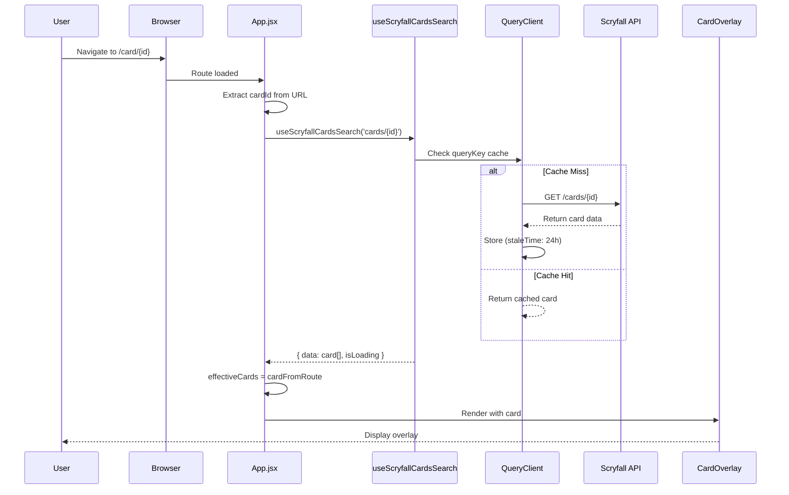
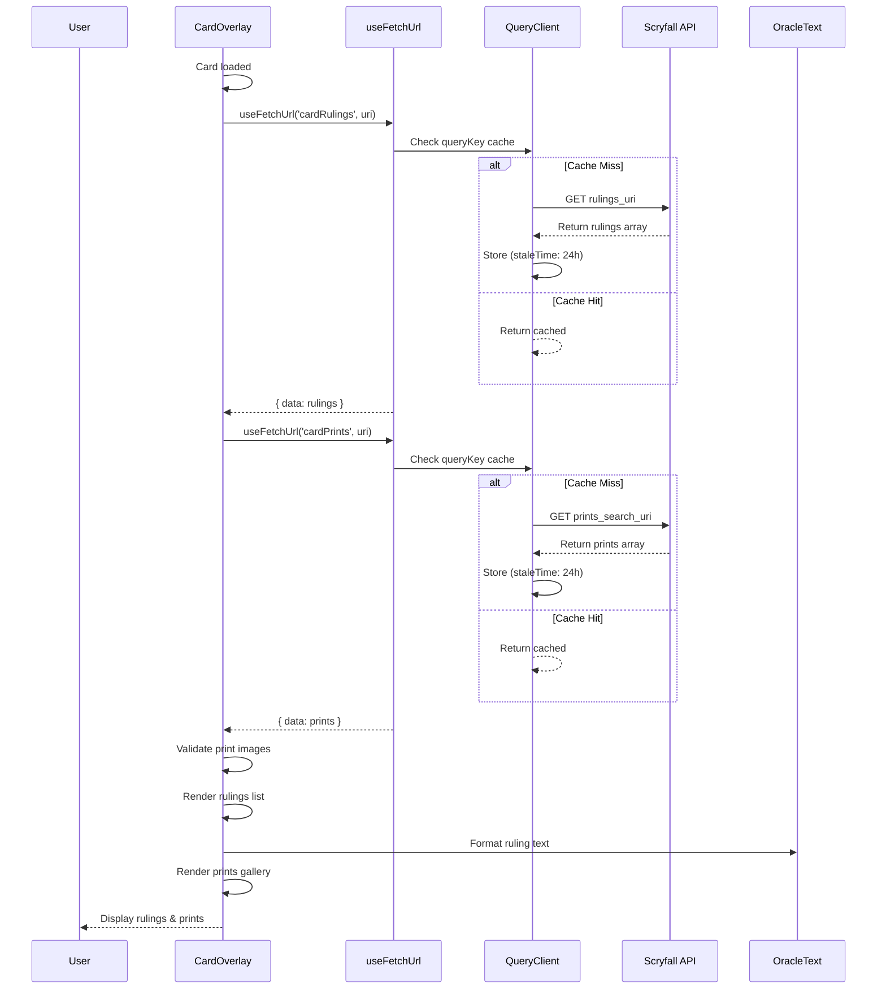
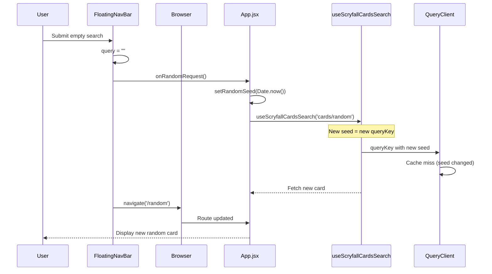

# Card Search Sequence Diagrams

## Scenario 1: Initial App Load → Random Card

## Scenario 2: User Searches by Card Name

## Scenario 3: Clicking a Card in the List to Open Overlay

## Scenario 4: Deep Link to Card (/card/:cardId)

## Scenario 5: Card Overlay - Loading Rulings & Prints

## Scenario 6: Empty Search → Redirect to Random

